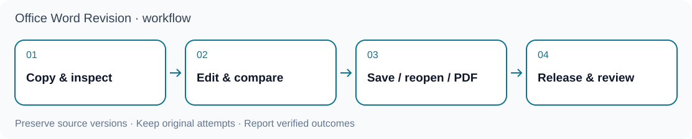

<p align="center"></p>

# OfficeCLI Academic Word

**Reproducible academic DOCX revision and thesis formatting, with explicit Word and citation checks.**

[繁體中文](README.zh-TW.md) · [简体中文](README.zh-CN.md) · [Agent quickstart](docs/agent-quickstart.md) · [Skill](skills/officecli-word-revision/SKILL.md) · [MIT license](LICENSE)

`officecli-word-revision` provides the `wordrev` command and an agent-readable skill. Keep the source immutable, build a separate candidate, preserve live citation fields, and report exactly what was checked. This is a **development preview**, currently `0.1.0.dev5`; it is not a universal, configuration-free DOCX comparison service.



## What it does

| Workflow | Supported scope | Required input |
|---|---|---|
| `manuscript_revision` | Native tracked revisions, accepted/rejected copies, layout and QA | Source as format authority, accepted content and a project adapter; private adapters are not included |
| `thesis_format` | A chapter, chapter batch or already merged thesis; styles, sections, page numbering, captions and reference layout | A versioned institution profile and explicit style/section mappings; no automatic chapter merging |
| Structural integrity | Read-only checks of bound content blocks, sections, fields, footnotes, captions and bibliography | A DOCX and its matching integrity contract |

Phase fingerprints and cached results support recovery. Frozen statistical artifacts are consumed through a manifest; this project does not run models or call NotebookLM. Structural checks, native rendering, Zotero refresh, visual review and scholarly validity are separate acceptance claims.

## Install

Use Python **3.10 or newer** in an isolated environment. These commands install the package and inspect the CLI; they do not start Word:

```sh
git clone https://github.com/lzhs1995/officecli-word-revision.git
cd officecli-word-revision
git checkout --detach 47f9d43be54f9320c14d32a39d4f0ce073bb4320
python3 -m venv .venv
.venv/bin/python -m pip install .
.venv/bin/wordrev --version
.venv/bin/wordrev --help
```

The commands above pin the runtime source to commit `47f9d43be54f9320c14d32a39d4f0ce073bb4320`; they use a POSIX shell. This documentation change does not replace that runtime pin. The package declares the `wordrev` entry point in [pyproject.toml](pyproject.toml). Pin a reviewed commit or release for a real job. Keep existing installations and in-flight jobs on their original version until an explicit handover.

For native production, install Microsoft Word, OfficeCLI and Poppler (`pdfinfo`, `pdftoppm`, `pdftotext`, `pdfimages`) separately. Citation creation or refresh also requires Zotero Desktop and its Word plugin. This package does not silently install applications, grant permissions or configure your citation library.

## First check: no Word required

From the repository root, generate a synthetic document and run its read-only structural checker. Use a new output directory:

```sh
.venv/bin/python skills/officecli-word-revision/scripts/make_thesis_fixture.py   --out-dir ./example-run
.venv/bin/python skills/officecli-word-revision/scripts/thesis_integrity.py   --docx ./example-run/synthetic-thesis.docx   --contract ./example-run/contract.json   --output ./example-run/check.json
```

The generator writes synthetic files; the checker reads the DOCX and writes a JSON report without changing the document. Its success proves only the contract's structural scope. For a real document, supply a contract bound to that document; do not reuse the synthetic contract.

Negative fixtures include `missing-reference`, `appendix-restart`, `bibliography-order` and `clipped-image`. The generator validates the expected outcome; running the checker on a failing fixture returns exit code `2`. See [the integrity contract](skills/officecli-word-revision/references/thesis-integrity.md).

## Work on a real document

First read the [scenario instructions](skills/officecli-word-revision/SKILL.md) and inspect `wordrev init --help`. Create a job with explicit source, adapter/profile, outputs and mappings. `manuscript-revision` initialization requires an accepted content source and a project adapter; thesis initialization requires a scope. The bundled RUC profile is an example based on a supplied requirements snapshot, not a guarantee of current institutional compliance. For another institution, create an appropriate profile and verify each rule against its actual source; do not apply RUC defaults automatically.

With a reviewed job and the native prerequisites ready:

```sh
.venv/bin/wordrev audit --job /absolute/path/job.json --resume
.venv/bin/wordrev layout --job /absolute/path/job.json --resume
.venv/bin/wordrev build --job /absolute/path/job.json --resume
.venv/bin/wordrev verify --job /absolute/path/job.json   --run-dir /absolute/path/run --resume
```

**`audit` is not a purely offline command.** It checks the toolchain and, by default, renders the source through Word. `layout` also invokes the audit. Coordinate native access before either command; review the audit before continuing to writes. Keep `notebooklm` disabled and `statistics.allow_execution` false. Outputs must be separate from the source and existing final deliveries.

## Native execution and limits

- **One native writer per Word/Zotero integration instance.** Agents sharing an instance must use the same coordination and OS lock. Separate output folders or different tool names do not authorize concurrent native writers. Independent frozen-file reading and QA can run in parallel.
- A timeout or uncertain close retains recovery evidence. Read back the original operation; do not clear pending state, kill another user's application or replay a job merely to obtain a clean status.
- Native paths have been exercised on **macOS with Microsoft Word**, with task-specific acceptance limits. A complete Windows production workflow has **not been accepted**; isolated experiments do not establish support. Linux is suitable for static and synthetic checks, not native Word rendering.
- Live Zotero citation/bibliography fields require the Word plugin route. OfficeCLI, library APIs and screenshots cannot substitute for native field creation or refresh. A macro returning does not prove refresh completed.
- A known native AutoFit path has encountered Word error `-10006`; this documentation update does not establish that it is fixed. Check the relevant native evidence for the version and environment you use.
- CI uses synthetic tests and packaging checks on Linux/macOS. It does not run licensed Word/Zotero applications or certify research conclusions. The RUC profile is not an official university endorsement.

## Version scope

| Channel | Identity | Meaning |
|---|---|---|
| Pinned development runtime | `0.1.0.dev5` / `47f9d43be54f9320c14d32a39d4f0ce073bb4320` | The source used by the installation example; development preview, not a stable-production promise |
| Documentation update | `docs/public-delivery-20261110` | Public onboarding changes only; final reviewed commit/PR is recorded at publication |

The package version and Git commit identify different things. Do not assume an older tag with the same package version points to this commit.

## Three complementary projects

| Project | Responsibility | Boundary |
|---|---|---|
| [Multi-Agent Collaboration (MAC)](https://github.com/lzhs1995/multi-agent-collaboration) | Collaboration, handoffs, ownership and recovery protocols | Does not make an unsafe shared Word instance parallel |
| [thesis-refiner](https://github.com/lzhs1995/thesis-refiner) | Dissertation review, evidence assessment and author decisions | Scientific acceptance remains distinct from document QA |
| **OfficeCLI Academic Word** | DOCX production, fields, formatting and native Word/PDF verification | Consumes approved content/results; does not estimate models or run NotebookLM |

These are complementary responsibilities, not an automatic installation dependency or permission grant. Statistical tools remain upstream; see [RStudio integration](docs/rstudio-integration.md).

## Use with an agent

Start at [AGENTS.md](AGENTS.md) and [the agent quickstart](docs/agent-quickstart.md). Claude and Gemini entry files point to the same instructions. Clients differ in filename discovery, skill installation and import behavior: **these files do not prove automatic loading or universal client support**. If your client does not discover them, explicitly ask it to read the files before acting.

Install the CLI and skill from the same pinned version. Register or copy `skills/officecli-word-revision` only through your client's documented skill mechanism; inspect existing targets first. No MCP reconfiguration or active-task migration happens automatically.

## Documentation and development

- [Manuscript revision](skills/officecli-word-revision/references/manuscript-revision.md) and [thesis formatting](skills/officecli-word-revision/references/thesis-format.md)
- [Whole-thesis guide](skills/officecli-word-revision/references/full-thesis-formatting.md), [rule provenance](skills/officecli-word-revision/references/ruc-rule-sources.json) and [electronic appendices](skills/officecli-word-revision/references/electronic-appendices.md)
- [Native closeout](skills/officecli-word-revision/references/native-closeout-evidence.md) and [rendering evidence](skills/officecli-word-revision/references/rendering-and-handoff-evidence.md)
- [Archived maintenance notes](docs/MAINTENANCE-NOTES.md), [release notes](CHANGELOG.md) and [release checklist](docs/release.md); dated reports retain their historical scope

```sh
.venv/bin/python -m unittest discover   -s skills/officecli-word-revision/scripts -p 'test_*.py' -v
.venv/bin/python -m pip wheel . --no-deps --wheel-dir dist
```

Read [SECURITY.md](SECURITY.md) for safe reporting. Publish generic code, rules and synthetic fixtures only. Keep real manuscripts, datasets, private adapters, credentials and execution logs out of public changes. Code is MIT licensed; external software and fonts keep their own licenses. This is not an official product of Microsoft, OfficeCLI, Zotero or Renmin University of China.
