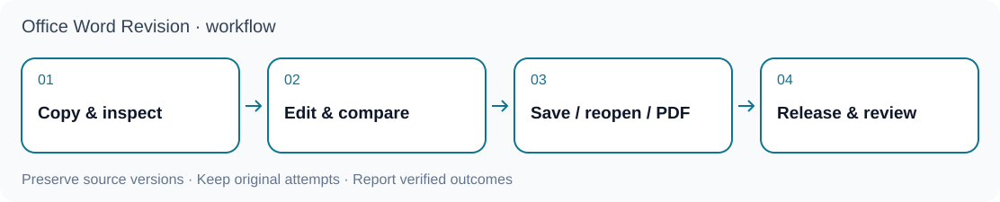

<p align="center"></p>

# OfficeCLI Academic Word

**可重現的學術DOCX修訂與學位論文排版，分別核驗Word原生結果與引用欄位。**

[English](README.md) · [简体中文](README.zh-CN.md) · [Agent快速開始](docs/agent-quickstart.md) · [技能入口](skills/officecli-word-revision/SKILL.md) · [MIT授權](LICENSE)

`officecli-word-revision`提供`wordrev`命令與agent可讀技能。保留來源檔、另建候選稿、保護動態引用欄位，並明確記錄實際核驗範圍。目前為**開發預覽版 `0.1.0.dev5`**，並非無須設定、適用任意兩份DOCX的通用比較服務。



## 功能範圍

| 工作流程 | 支援範圍 | 必要輸入 |
|---|---|---|
| `manuscript_revision` | 原生追蹤修訂、接受／拒絕副本、版面與品質檢查 | 以原稿為格式依據、已確認內容，以及專案適配器；私人適配器不包含在本倉庫 |
| `thesis_format` | 單章、章節批次或已合併論文的樣式、分節、頁碼、題注與書目格式 | 有版本的學校規範設定及明確樣式／分節對應；不自動合併章節 |
| 結構完整性檢查 | 唯讀核對內容區塊、分節、欄位、註腳、題注與書目 | DOCX及與該文件綁定的檢查契約 |

各階段的指紋與快取支援恢復作業。統計產物透過清單讀取；本專案不重新估計模型，也不呼叫NotebookLM。結構檢查、原生排版、Zotero更新、視覺檢閱與學術有效性，必須分開認定。

## 安裝

使用**Python 3.10以上**與獨立虛擬環境。下列命令安裝套件並檢查CLI，不會啟動Word：

```sh
git clone https://github.com/lzhs1995/officecli-word-revision.git
cd officecli-word-revision
git checkout --detach 47f9d43be54f9320c14d32a39d4f0ce073bb4320
python3 -m venv .venv
.venv/bin/python -m pip install .
.venv/bin/wordrev --version
.venv/bin/wordrev --help
```

以上將執行期原始碼固定於`47f9d43be54f9320c14d32a39d4f0ce073bb4320`，採用POSIX shell；此次文件更新不替換這個執行期指紋。[pyproject.toml](pyproject.toml)定義實際`wordrev`入口。正式作業應固定到已審閱的commit或版本；既有安裝與執行中作業沿原版本繼續，明確交接後才切換。

原生產製另需安裝Microsoft Word、OfficeCLI及Poppler（`pdfinfo`、`pdftoppm`、`pdftotext`、`pdfimages`）。建立或更新引用還需要Zotero桌面程式及Word外掛。本套件不會靜默安裝應用程式、授予權限或設定文獻庫。

## 首次檢查：不需要Word

在倉庫根目錄執行，使用尚不存在的輸出目錄：

```sh
.venv/bin/python skills/officecli-word-revision/scripts/make_thesis_fixture.py   --out-dir ./example-run
.venv/bin/python skills/officecli-word-revision/scripts/thesis_integrity.py   --docx ./example-run/synthetic-thesis.docx   --contract ./example-run/contract.json   --output ./example-run/check.json
```

產生器寫入合成範例；檢查器讀取DOCX並寫出JSON報告，不改動文件。通過只代表契約涵蓋的結構項目。真實文件必須使用與其綁定的契約，不能直接套用合成範例契約。

反例包含`missing-reference`、`appendix-restart`、`bibliography-order`及`clipped-image`。產生器會核對預期結果；對失敗反例單獨執行檢查器，退出碼為`2`。詳見[結構檢查契約](skills/officecli-word-revision/references/thesis-integrity.md)。

## 處理真實文件

先讀[情境規則](skills/officecli-word-revision/SKILL.md)及`wordrev init --help`，明確設定來源、適配器／規範、輸出與對應關係。`manuscript-revision`初始化需要已確認內容來源及專案適配器；論文排版初始化需要指定範圍。內建人大規範是依使用者提供快照建立的示例profile，不保證符合學校目前全部要求。其他學校須自建適用profile，逐項核實規範來源，不自動套用人大預設值。

作業設定已審閱、原生環境與協調已準備好後：

```sh
.venv/bin/wordrev audit --job /absolute/path/job.json --resume
.venv/bin/wordrev layout --job /absolute/path/job.json --resume
.venv/bin/wordrev build --job /absolute/path/job.json --resume
.venv/bin/wordrev verify --job /absolute/path/job.json   --run-dir /absolute/path/run --resume
```

**`audit`不是純離線命令。** 它會檢查工具鏈，預設會透過Word呈現來源稿；`layout`也會先呼叫稽核。執行前須完成原生資源協調，並先檢視稽核結果再進行寫入。保持`notebooklm`停用、`statistics.allow_execution=false`，輸出與來源及既有終稿分開。

## 原生執行與限制

- **同一Word／Zotero整合實例只能有一個原生寫入者。** 不同agent必須共用協調機制與OS鎖；不同輸出目錄或工具名稱不構成平行寫入授權。已固定文件的獨立閱讀與離線檢查可以並行。
- 逾時或關閉結果不明時保留恢復證據，先讀回原操作；不得僅為取得乾淨狀態而清除pending、終止他人的程式或重送作業。
- **macOS＋Microsoft Word**已有原生路徑實測，驗收範圍仍依各實際作業記錄。**Windows完整產製流程尚未驗收**，局部實驗不等於支援承諾；Linux適合靜態與合成檢查，不提供原生Word排版。
- 動態Zotero引用與書目欄位須走Word外掛路徑。OfficeCLI、文獻庫API或截圖不能代替原生欄位建立／更新；巨集返回也不代表更新完成。
- 已知原生AutoFit路徑曾遇Word `-10006`錯誤；此次文件更新不代表已修復，須核對實際版本與環境的原生證據。
- CI在Linux／macOS執行合成測試與套件檢查，不運行需授權的Word／Zotero，也不認證研究結論。人大規範設定並非校方背書。

## 版本範圍

| 渠道 | 身份 | 意義 |
|---|---|---|
| 固定開發執行期 | `0.1.0.dev5`／`47f9d43be54f9320c14d32a39d4f0ce073bb4320` | 安裝範例使用的原始碼；屬開發預覽，不承諾穩定產製 |
| 文件更新 | `docs/public-delivery-20261110` | 僅公開上手文件；發布時記錄最終已審commit／PR |

套件版本與Git提交不是同一身份；不能假設同套件版本的舊tag就指向此提交。

## 三個專案的分工

| 專案 | 責任 | 邊界 |
|---|---|---|
| [Multi-Agent Collaboration（MAC）](https://github.com/lzhs1995/multi-agent-collaboration) | 協作、交接、所有權與恢復協議 | 不會讓共用Word實例變成可安全平行寫入 |
| [thesis-refiner](https://github.com/lzhs1995/thesis-refiner) | 論文審閱、證據判斷與作者決策 | 科學驗收與文件品質檢查分開 |
| **OfficeCLI Academic Word** | DOCX產製、欄位、格式及原生Word／PDF核驗 | 消費已確認內容／結果，不估計模型、不呼叫NotebookLM |

這是互補責任，不是自動安裝相依關係或權限授予。統計工具位於上游；詳見[RStudio銜接](docs/rstudio-integration.md)。

## 供agent使用

從[AGENTS.md](AGENTS.md)與[快速開始](docs/agent-quickstart.md)閱讀。Claude及Gemini入口指向同一份規則。各客戶端對檔名探索、技能安裝及引用方式的支援不同，**不能因檔案存在就宣稱自動載入或普遍相容**；不會自動探索時，明確要求agent先讀指定檔案。

CLI與技能應採同一固定版本。只沿客戶端文件所述方式註冊或複製`skills/officecli-word-revision`，先檢查既有目標；不自動重設MCP，也不自動遷移執行中作業。

## 文件與開發

- [稿件修訂](skills/officecli-word-revision/references/manuscript-revision.md)、[學位論文排版](skills/officecli-word-revision/references/thesis-format.md)
- [全書整合指南](skills/officecli-word-revision/references/full-thesis-formatting.md)、[規範來源](skills/officecli-word-revision/references/ruc-rule-sources.json)、[電子附錄](skills/officecli-word-revision/references/electronic-appendices.md)
- [原生收尾](skills/officecli-word-revision/references/native-closeout-evidence.md)、[呈現與交付證據](skills/officecli-word-revision/references/rendering-and-handoff-evidence.md)
- [舊維護說明](docs/MAINTENANCE-NOTES.md)、[變更紀錄](CHANGELOG.md)、[發布檢查表](docs/release.md)；有日期的報告保留其歷史範圍

```sh
.venv/bin/python -m unittest discover   -s skills/officecli-word-revision/scripts -p 'test_*.py' -v
.venv/bin/python -m pip wheel . --no-deps --wheel-dir dist
```

安全通報方式見[SECURITY.md](SECURITY.md)。公開內容限通用程式、規則與合成範例。真實論文、資料集、私人適配器、憑證與執行日誌不應進入公開變更。程式採MIT授權；外部軟體與字型沿各自授權。本專案不是Microsoft、OfficeCLI、Zotero或中國人民大學的官方產品。
